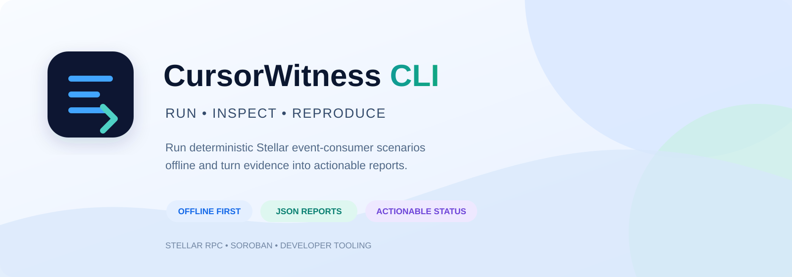
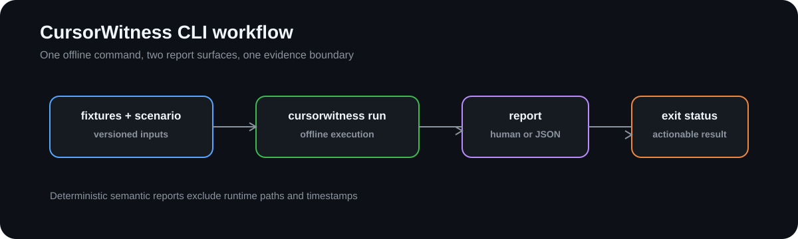

# CursorWitness CLI



[](https://github.com/CursorWitness/cursorwitness-cli/actions/workflows/ci.yml)
[](LICENSE)
[](https://nodejs.org/)
[](#project-status)

The offline executable for [CursorWitness](https://github.com/CursorWitness).

The CLI turns deterministic fixtures, consumer adapters, fault plans, and independent assertions into a repeatable developer workflow. It owns argument parsing, filesystem boundaries, presentation, and exit-code behavior; the correctness model remains in [`cursorwitness-core`](https://github.com/CursorWitness/cursorwitness-core).

## Repository role

The CLI owns offline execution and reproducible report presentation:

```text
fixture + scenario + adapter
              │
              ▼
       cursorwitness run
              │
       JSON or human report
              │
       actionable exit status
```

The CLI is offline by default. It does not load wallet credentials, call a live RPC provider, or infer database durability from an in-memory callback.

## Quick start

Requirements: Node.js 20.19+ and pnpm 10.12+.

```bash
pnpm install --frozen-lockfile
pnpm run verify
```

Build and invoke the executable:

```bash
pnpm run build
node dist/cli.js --help
```

Example inputs are in [`examples/`](examples/). Reports are versioned semantic evidence: runtime paths, timestamps, and other nondeterministic metadata are excluded from the semantic comparison.

## What the CLI reports

- observed deliveries and event identity;
- handler invocation count;
- attempted and committed business effects;
- checkpoint persistence observations;
- crash/restart boundaries;
- invariant violations with actionable evidence;
- `unverified` boundaries where the adapter cannot expose durable state.

Duplicate delivery is not automatically a failure. The CLI distinguishes it from duplicate handler invocation and duplicate committed business effect.

## Documentation map

- [`examples/`](examples/) — small deterministic scenario inputs
- [`src/`](src/) — CLI parsing, execution, and report presentation
- [`test/`](test/) — CLI contract and filesystem-boundary tests
- [`CONTRIBUTING.md`](CONTRIBUTING.md) — contribution workflow
- [`SECURITY.md`](SECURITY.md) — security boundaries and reporting
- [`CODE_OF_CONDUCT.md`](CODE_OF_CONDUCT.md) — community standards
- [`CHANGELOG.md`](CHANGELOG.md) — release and change history

## Project status

This repository is an implementation seam for the CursorWitness v0.1.0 development line. It is not published to npm; its core dependency is pinned to a verified Git commit while the public API stabilizes.

## Related repositories

- [`cursorwitness-core`](https://github.com/CursorWitness/cursorwitness-core) — contracts, fixtures, oracle, and report model
- [`cursorwitness-adapters`](https://github.com/CursorWitness/cursorwitness-adapters) — consumer-specific integration seams

## Visual guide



## License

Apache-2.0. See [`LICENSE`](LICENSE).

See also: [`CONTRIBUTING.md`](CONTRIBUTING.md) · [`SECURITY.md`](SECURITY.md) · [`CODE_OF_CONDUCT.md`](CODE_OF_CONDUCT.md) · [`CHANGELOG.md`](CHANGELOG.md)
